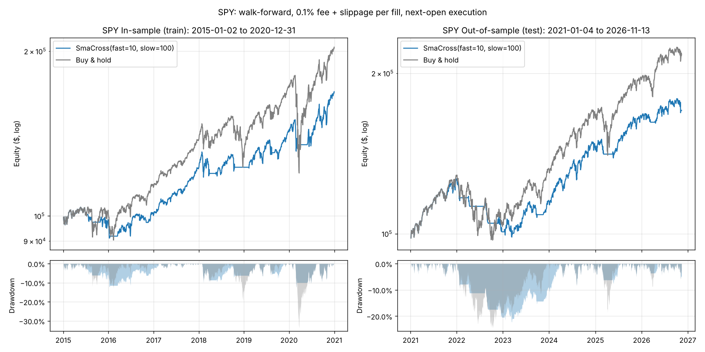
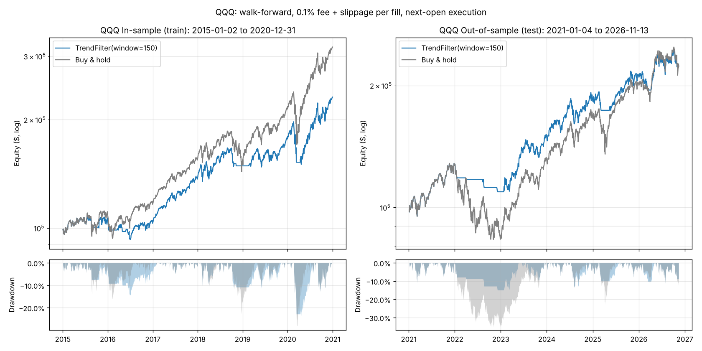

# Walk-forward backtest results

- Train: 2015-01-01 to 2020-12-31 | Test: 2021-01-01 to latest
- Costs per fill: fee 0.10%, slippage 0.05%; signals at close, fills at next open
- Candidates: 13 (SMA crossovers and trend filters), objective: sharpe

| ticker | segment | strategy | cagr | max_drawdown | sharpe | win_rate | trade_count | exposure | final_equity |
|---|---|---|---|---|---|---|---|---|---|
| SPY | train / strategy | SmaCross(fast=10, slow=100) | 9.1% | -12.4% | 0.80 | 75.0% | 9 | 80.7% | $168,641 |
| SPY | train / buy&hold | BuyAndHold | 12.6% | -33.7% | 0.74 | n/a | 1 | 100.0% | $203,342 |
| SPY | test / strategy | SmaCross(fast=10, slow=100) | 9.5% | -22.3% | 0.85 | 50.0% | 10 | 78.5% | $170,394 |
| SPY | test / buy&hold | BuyAndHold | 14.1% | -24.5% | 0.88 | n/a | 1 | 100.0% | $216,680 |
| QQQ | train / strategy | TrendFilter(window=150) | 15.0% | -23.8% | 0.94 | 43.8% | 17 | 85.4% | $231,079 |
| QQQ | train / buy&hold | BuyAndHold | 21.3% | -28.6% | 1.01 | n/a | 1 | 100.0% | $318,199 |
| QQQ | test / strategy | TrendFilter(window=150) | 14.7% | -14.9% | 0.94 | 46.7% | 15 | 77.5% | $223,531 |
| QQQ | test / buy&hold | BuyAndHold | 14.7% | -35.1% | 0.72 | n/a | 1 | 100.0% | $222,761 |

## SPY

Selected on training data (sharpe): **SmaCross(fast=10, slow=100)**

Top in-sample candidates:

```
                   strategy   sharpe     cagr  max_drawdown  trade_count
SmaCross(fast=10, slow=100) 0.797940 0.091069     -0.124372            9
SmaCross(fast=10, slow=200) 0.593844 0.071575     -0.189484            7
    TrendFilter(window=100) 0.560388 0.056326     -0.164708           36
    TrendFilter(window=200) 0.523025 0.057407     -0.200059           17
SmaCross(fast=10, slow=150) 0.518459 0.060092     -0.213940            8
```



## QQQ

Selected on training data (sharpe): **TrendFilter(window=150)**

Top in-sample candidates:

```
                   strategy   sharpe     cagr  max_drawdown  trade_count
    TrendFilter(window=150) 0.936004 0.149918     -0.238177           17
SmaCross(fast=10, slow=100) 0.796513 0.121301     -0.221439           12
SmaCross(fast=10, slow=150) 0.762383 0.126389     -0.287194            7
SmaCross(fast=50, slow=200) 0.742371 0.138994     -0.285594            5
SmaCross(fast=10, slow=200) 0.712062 0.120368     -0.300297            7
```


